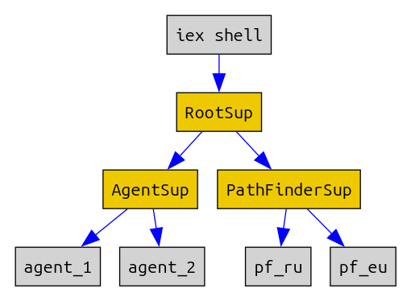

# Использование супервизора

## Запускаем Agent под супервизором

Возьмем ShardManager из 2-го урока. Его нужно будет немного доработать. 

Функцию для запуска процесса общепринято называть `start_link`, и она должна принимать один аргумент. Можно назвать функцию иначе, и аргументов сделать больше, но тогда в супервизоре придется переопределять настройки по-умолчанию, что менее удобно.

Проще передать нужные аргументы в виде кортежа:

```
def start_link({agent_name, nodes, num_shards}) do
  state = make_state(nodes, num_shards)
  Agent.start(fn () -> state end, [name: agent_name])
end
```

Формирование стейта у нас было прямо внутри функции `start/2`. Вынесем его в отдельную функцию, чтобы не дублировать:

```
defp make_state(nodes, num_shards) do
  ...
  %{num_shards: num_shards, shard_ranges: shard_ranges}
end
``` 

Добавим функцию `find_node`, которая будет отличаться тем, что принимет имя агента. И поэтому она может делать запросы к разным агентам.

```
def find_node(agent_name, shard) do
  Agent.get(agent_name, fn(state) -> get_node(state, shard_num) end)
end
```

Запустим одного агента, и будем использовать child specification по-умолчанию:

```
def start_with_sup() do
  nodes = ["node-1", "node-2", "node-3", "node-4"]

  child_spec = [
    {ShardManager, {:agent_1, nodes, 32}}
  ]
  Supervisor.start_link(child_spec, strategy: :one_for_all)
end
```

Здесь child specification выглядит предельно просто:

```
{ShardManager, {:agent_1, state}}
```

Это модуль агента, и аргументы для start_link. Этого достаточно, потому что в модуле агента мы применяем магию:

```
use Agent
```

Это специальный макрос, который неявно добавляет в модуль функцию `child_spec/1`. Супервизор вызывает эту функцию и получает child specification непосредственно от модуля, который он собирается запускать.

В Эликсире (в отличие от Эрланга) принято соглашение, что каждый модуль сам определяет child specification, необходимый для его запуска. Для Task, Agent и GenServer это генерируется неявно со значениями по умолчанию.

Если мы захотим что-то переопределить, что достаточно передать нужные ключи в макрос:

```
use Agent, restart: :permanent
```

и макрос сгенерирует нужную реализацию.

Запускаем и смотрим, как это работает:

```
$ iex shard_manager.exs

> ShardManager.child_spec(:no_arg)
%{
  id: ShardManager,
  restart: :permanent,
  start: {ShardManager, :start_link, [:no_arg]}
}

> ShardManager.start_with_sup
{:ok, #PID<0.121.0>}
> ShardManager.find_node(:agent_1, 1)
{:ok, "node-1"}
> ShardManager.find_node(:agent_1, 5)
{:ok, "node-1"}
> ShardManager.find_node(:agent_1, 50)
{:error, :not_found}
> ShardManager.find_node(:agent_1, 30)
{:ok, "node-4"}
```

## Запускаем двух агентов

Если мы хотим запустить двух агентов, то понадобятся разные `id` в child specification. Реализация по-умолчанию подставляет в качестве id имя модуля (что является общепринятой практикой). 

Но мы не можем запустить двух агентов с одинаковым id, поэтому придется явно указать child specification:

```
  def start_2_agents() do
    nodes_1 = ["node-a1", "node-a2", "node-a3", "node-a4"]
    nodes_2 = ["node-b1", "node-b2", "node-b3", "node-b4"]
    child_spec = [
      %{
        id: :agent_a,
        start: {ShardManager, :start_link, [{:agent_a, nodes_1, 10}]}
      },
      %{
        id: :agent_b,
        start: {ShardManager, :start_link, [{:agent_b, nodes_2, 16}]}
      }
    ]
    Supervisor.start_link(child_spec, strategy: :one_for_all)
  end
```

Смотрим, как это работает:

```
> ShardManager.start_2_agents
{:ok, #PID<0.121.0>}
> ShardManager.find_node(:agent_a, 1)
{:ok, "node-a1"}
> ShardManager.find_node(:agent_a, 5)
{:ok, "node-a2"}
> ShardManager.find_node(:agent_a, 10)
{:ok, "node-a4"}
> ShardManager.find_node(:agent_a, 11)
{:error, :not_found}
> ShardManager.find_node(:agent_b, 1)
{:ok, "node-b1"}
> ShardManager.find_node(:agent_b, 5)
{:ok, "node-b2"}
> ShardManager.find_node(:agent_b, 10)
{:ok, "node-b3"}
> ShardManager.find_node(:agent_b, 11)
{:ok, "node-b3"}
```

(В Эрланг такого рода макросов нет, и все child specification всегда нужно явно прописывать. Впрочем, многие считают это преимуществом исходя из принципа "явное лучше неявного").


## Запускаем Task под супервизором

Модуль [Task.Supervisor](https://hexdocs.pm/elixir/1.12/Task.Supervisor.html) предоставляет аналогичное АПИ как и модуль [Task](https://hexdocs.pm/elixir/1.12/Task.html)

Так что нам достаточно вместо:

```
result_stream = Task.async_stream(children, &map_reduce/1)
```

сделать

```
{:ok, sup_pid} = Task.Supervisor.start_link()
result_stream = Task.Supervisor.async_stream(sup_pid, children, &map_reduce/1)
```

(и ещё поправить пути к файлам)

и все работает:

```
$ iex map_reduce_with_sup.exs
> MapReduce.start
...
3601
```

Task можно запустить под обычным супервизором так же, как мы выше запускали Agent:

```
child_spec = [
  {MyTaskModule, args}
]
Supervisor.start_link(child_spec, strategy: :one_for_all)
```

Но в этом случае нет способа получить результат работы Task. Это подходит для каких нибудь фоновых задач, как, например, прогрев кэшей.


## Запускаем GenServer под супервизором

Запустим PathFinder из прошлого урока. Поскольку там есть `use GenServer`, то и функция `child_spec/1` тоже есть:

```
> c "lib/path_finder_with_sup.exs"
> PathFinder.child_spec(:no_args)
%{id: PathFinder, start: {PathFinder, :start_link, [:no_args]}}
```

Запуск сервера нужно поправить, вместо:

```
def start() do
  GenServer.start(__MODULE__, :no_args, [name: @server_name])
end
```

сделаем функцию `start_link`, которая принимает имя сервера и путь к файлу с данными. Это позволит запустить несколько таких серверов с разными данными (чем мы воспользуемся позже):

```
def start_link(name, cities_file) do
  GenServer.start_link(__MODULE__, cities_file, [name: name])
end
```

Путь к файлу нужно будет сохранить в стейте и использовать в отложенной инициализации:
```
def init(cities_file) do
  state = %{
    cities_file: cities_file
  }
  {:ok, state, {:continue, :delayed_init}}
end

def handle_continue(:delayed_init, state) do
  ...
  data = load_data(state.cities_file)
  ...
```

Добавим запуск через супервизор:

```
def start() do
  children = [
    %{
      id: @server_name,
      start: {__MODULE__, :start_link, [@server_name, "./data/cities_ru.csv"]}
    },
  ]
  Supervisor.start_link(children, strategy: :one_for_all)
end
```

Запускаем и проверяем:

```
> PathFinder.start()
{:ok, #PID<0.163.0>}
> PathFinder.get_route("Москва", "Брянск")
{:ok, ["Москва", "Брянск"], 364}
> PathFinder.get_route("Иркутск", "Тюмень")
{:ok, ["Иркутск", "Казань", "Брянск", "Тюмень"], 7921}
```

И если мы хотим запускать несколько PathFinder, то нужен отдельный `get_route` где можно указать, на каком PathFinder его вызывать:

```
def get_route(name, city1, city2) do
  GenServer.call(name, {:get_route, city1, city2})
end

> PathFinder.get_route(PathFinder, "Иркутск", "Тюмень")
{:ok, ["Иркутск", "Казань", "Брянск", "Тюмень"], 7921}
```


## Дерево супервизоров

Нам еще нужно научиться запускать супервизор под супервизором. И тогда мы можем построить дерево из супервизоров и рабочих процессов.

Дочерний супервизор должен быть представлен отдельны модулем, чтобы было что запускать. Как и для GenServer, существует Supervisor behaviour, который нужно реализовать в этом модуле. behaviour требует наличия только одной функции -- `init/1`.

Создадим супервизор, который запускает два ShardManager:
```
  defmodule AgentSup do
    use Supervisor

    def start_link(_) do
      IO.puts("AgentSup.start_link #{inspect self()}")
      Supervisor.start_link(__MODULE__, :no_args)
    end
    
    @impl true
    def init(_) do
      IO.puts("AgentSup.init #{inspect self()}")
      ...
    end
  end
```

Начинаем с функции `start_link/0`:

```
def start_link(_) do
  Supervisor.start_link(__MODULE__, :no_args)
end
```

Здесь мы просим Supervisor запустить новый процесс для дочернего супервизора. Новый процесс входит в `loop` и вызывает callback `init/1`.

Внутри init декларируются дочерние процессы и вызывается `Supervisor.init`: 

```
  defmodule AgentSup do
    
    @impl true
    def init(_) do
      IO.puts("AgentSup.init #{inspect self()}")

      nodes_1 = ["node-a1", "node-a2", "node-a3", "node-a4"]
      nodes_2 = ["node-b1", "node-b2", "node-b3", "node-b4"]
      child_spec = [
        %{
          id: :agent_a,
          start: {ShardManager, :start_link, [{:agent_a, nodes_1, 10}]}
        },
        %{
          id: :agent_b,
          start: {ShardManager, :start_link, [{:agent_b, nodes_2, 16}]}
        }
      ]
      Supervisor.init(child_spec, strategy: :one_for_all)
    end
  end
```

Аналогично реализуем PathFinderSup, который запускает два PathFinder:

```
  defmodule PathFinderSup do
    use Supervisor

    def start_link(_) do
      IO.puts("PathFinderSup.start_link #{inspect self()}")
      Supervisor.start_link(__MODULE__, :no_args)
    end
    
    @impl true
    def init(_) do
      IO.puts("PathFinderSup.init #{inspect self()}")
      child_spec = [
        %{
          id: :pf_ru,
          start: {PathFinder, :start_link, [:pf_ru, "./data/cities_ru.csv"]}
        },
        %{
          id: :pf_eu,
          start: {PathFinder, :start_link, [:pf_eu, "./data/cities_eu.csv"]}
        }
      ]
      Supervisor.init(child_spec, strategy: :one_for_all)
    end
  end
```

Теперь создадим корневой супервизор, который запускает два дочерних супервизора:

```
  defmodule RootSup do
    use Supervisor

    def start_link(_) do
      IO.puts("RootSup.start_link #{inspect self()}")
      Supervisor.start_link(__MODULE__, :no_args)
    end
    
    @impl true
    def init(_) do
      IO.puts("RootSup.init #{inspect self()}")
      child_spec = [
        App.AgentSup,
        App.PathFinderSup
      ]
      Supervisor.init(child_spec, strategy: :one_for_all)
    end
  end
```

И запустим корневой супервизор:

```
defmodule App do

  def start() do
    IO.puts("App.start #{inspect self()}")
    App.RootSup.start_link(:no_args)
  end
```

Теперь всё это соберём и запустим:

```
> c "lib/shard_manager_with_sup.exs"
> c "lib/path_finder_with_sup.exs"
> c "lib/sup_tree.exs"

> App.start()
App.start #PID<0.109.0>
RootSup.start_link #PID<0.109.0>
RootSup.init #PID<0.146.0>
AgentSup.start_link #PID<0.146.0>
AgentSup.init #PID<0.147.0>
PathFinderSup.start_link #PID<0.146.0>
PathFinderSup.init #PID<0.150.0>
{:ok, #PID<0.146.0>}

> ShardManager.find_node(:agent_a, 5)
{:ok, "node-a2"}
> ShardManager.find_node(:agent_b, 5)
{:ok, "node-b2"}

> PathFinder.get_route(:pf_ru, "Иркутск", "Тюмень")
{:ok, ["Иркутск", "Казань", "Брянск", "Тюмень"], 7921}
> PathFinder.get_route(:pf_ru, "Barcelona", "Vienna")
{:error, :no_route}
> PathFinder.get_route(:pf_eu, "Barcelona", "Vienna")
{:ok, ["Barcelona", "Vienna"], 1989}
```

Таким образом у нас получилось дерево процессов:

