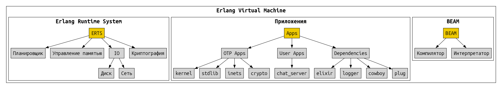
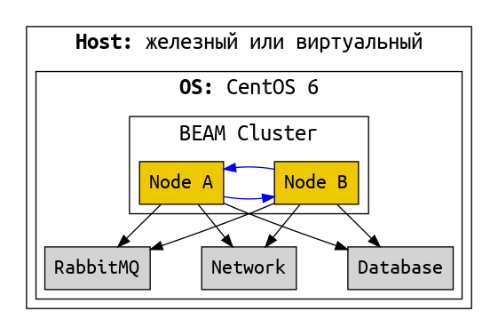
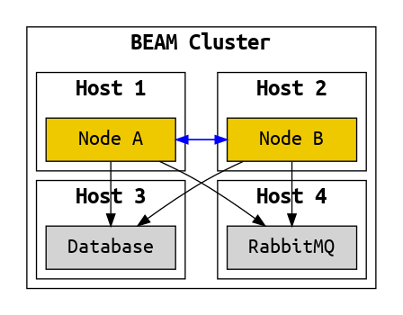
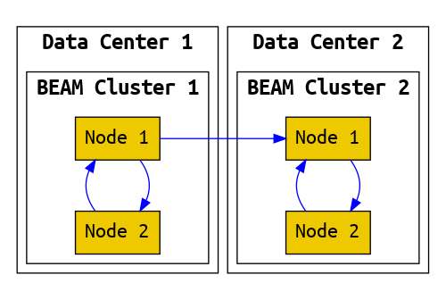

# Релиз

Ещё одна важная часть OTP это набор инструментов для сборки **релиза** -- упакованного для доставки на прод проекта. 

В состав релиза входит:
- скомпилированный код (байткод) всех Application;
- байткод всех необходимых зависимостей;
- скрипты загрузки системы;
- скрипты для управления системой (запуска, остановка, remote console и тд);
- конфигурация;
- ERTS -- Erlang Runtime System (виртуальная машина).

В состав релиза не входит:
- mix;
- исходный код;
- код тестов;
- зависимости, нужные только для тестов;
- любые файлы проекта, для которых явно не указано, что они должны быть в релизе.

Опционально в состав релиза можно включить ERTS (виртуальную машину). Если мы не включаем виртуальную машину, то она должна быть установлена на тех хостах, куда мы будем доставлять проект. Причем, что важно, в нужной версии. Бывает проще включить виртуальную машину в состав релиза, и тогда не требуется её наличия на хостах.

В обоих случаях доставленая и развёрнутая на хосте система выглядит так:



Это минимальная система, состоящая из одного узла.

Не редко система представляет собой кластер из нескольких узлов. Причём этот кластер не самодостаточный, а ему необходимо наличие базы данных, очереди сообщений и взаимодействие с другими системами по сети:



В этом варианте все компоненты развернуты на одном хосте. Такое бывает на стейджинг окружениях и на машине разработчика. Но реально использующаяся система (production) разворачивается на нескольких хостах:



Если пойти еще дальше, то можно построить федерацию -- систему из нескольких кластеров, находящихся в разных датацентрах:




## Сборка и запуск

Давайте соберём релиз `chat_server`: 

```
$ mix release
* assembling chat_server-0.1.0 on MIX_ENV=dev
* skipping runtime configuration (config/runtime.exs not found)

Release created at _build/dev/rel/chat_server
...
```

И посмотрим из чего он состоит:

```
$ tree -L 2 _build/dev/rel/chat_server
_build/dev/rel/chat_server
├── bin
│   ├── chat_server
│   └── chat_server.bat
├── erts-17.0.2
│   └── bin
├── lib
│   ├── chat_server-0.1.0
│   ├── compiler-10.0.1
│   ├── elixir-1.20.1
│   ├── iex-1.20.1
│   ├── kernel-11.0.2
│   ├── logger-1.20.1
│   ├── sasl-4.4
│   └── stdlib-8.0.1
└── releases
    ├── 0.1.0
    ├── COOKIE
    └── start_erl.data
```

`bin` -- исполняемые файлы для запуска приложения.
`erts` -- erlang runtime system.
`lib` -- байт-код приложения и всех зависимостей.
`release` -- служебные файлы для загрузки, конфигурации и обновления.

Посмотрим, как запустить приложение:
```
$ cd _build/dev/rel/chat_server/bin
$ ./chat_server
Usage: chat_server COMMAND [ARGS]

The known commands are:

    start          Starts the system
    start_iex      Starts the system with IEx attached
    daemon         Starts the system as a daemon
    daemon_iex     Starts the system as a daemon with IEx attached
    eval "EXPR"    Executes the given expression on a new, non-booted system
    rpc "EXPR"     Executes the given expression remotely on the running system
    remote         Connects to the running system via a remote shell
    restart        Restarts the running system via a remote command
    stop           Stops the running system via a remote command
    pid            Prints the operating system PID of the running system via a remote command
    version        Prints the release name and version to be booted
```

В кубе можно запускать прямо в консоли:
```
$ ./chat_server start      
ChatServer.start [:hello, :world]
Start SessionManager
```

Но если у нас виртуалка без куба, то нужно запускать как фоновый процесс:
```
$ ./chat_server daemon
```

Подключиться iex-консолью к работающему узлу можно так:
```
$ ./chat_server remote
Erlang/OTP 29 [erts-17.0.2] [source] [64-bit] [smp:20:20] [ds:20:20:10] [async-threads:1] [jit:ns]

Interactive Elixir (1.20.1) - press Ctrl+C to exit (type h() ENTER for help)
iex(chat_server@yury-zhloba-desktop)1> Application.started_applications()
[
  {:iex, ~c"iex", ~c"1.20.1"},
  {:chat_server, ~c"chat_server", ~c"0.1.0"},
  {:logger, ~c"logger", ~c"1.20.1"},
  {:sasl, ~c"SASL  CXC 138 11", ~c"4.4"},
  {:elixir, ~c"elixir", ~c"1.20.1"},
  {:compiler, ~c"ERTS  CXC 138 10", ~c"10.0.1"},
  {:stdlib, ~c"ERTS  CXC 138 10", ~c"8.0.1"},
  {:kernel, ~c"ERTS  CXC 138 10", ~c"11.0.2"}
]
```

Ну и остановить фоновый процесс:
```
$ ./chat_server stop
```

## Как работает конфигурация

BEAM на старте читает все настройки из sys.config
В принципе, можно было бы этим и пользоваться. Но sys.config неудобен тем, что в конфигурация в нем описана в erlang term. 
Здесь легко сделать синтаксическую ошибку -- не хватает запятой, или лишняя -- и нода не стартует. А валидации синтаксиса нет.
Даже опытный эрлангист может сделать ошибку. А конфигурацией занимается не только разработчик, но и QA, и DevOps.

А еще для этого файла трудно сделать шаблон, так как синтаксис эрланга будет смешан с синтаксисом шаблона. 

Поэтому обычно идут по другому пути -- генерируют sys.config автоматически из каких-то других конфигов. 
Эликсир тоже идет по этому пути.

dev, test, prod - конфиги. 
releases-конфиг -- это устарело, нужно осваивать ConfigProviders
compile-time and run-time configuration

Config providers are executed prior to boot, and the resulting application env is then persisted to a final sys.config, which is then used by the release itself.

Environment -- A named set of configuration settings which apply to all releases built for that environment. It differs from Mix’s environment, in that it refers to the target environment, not the build environment.

Profile -- A specific combination of release and environment configuration settings.
по идее можно подготовить отдельный профиль для каждого deployment host.

sys.config -- A static file containing Erlang terms, it is one way configuration can be provided to a release.
vm.args -- A file which provides configuration to the Erlang VM when it starts a release.

_build/prod/rel/proj_name/releases/0.1.0/
where 0.1.0 is a version of your application as provided in mix.exs

vm.args
The vm.args file is how one provides configuration for the Erlang VM itself. 
can be used to provide flags to the Erlang runtime
+P sets the maximum number of running processes
Some basic defaults are generated by distillery (node name, cookie)
hexdocs.pm/distillery/configuration.html

sys.config
contains OTP environment variables as specified in mix.exs and config.exs

окружения dev, test, prod, настройки для них.

если мы доставим релиз на несколько хостов, то везде будет идентичная конфигурация
обычно это не то, чего мы хотим
настройки для конкретной машины -- через переменные окружения.

sys.config -- настройки на уровне релиза, одинаковые для всех машин
двойной запуск для генерации sys.config

prod-конфиги запакованы в релиз. Это значит, они идентичные на всех машинах, куда релиз будет доставлен. Как сделать разную конфигурацию для разных машин? Способ "из коробки" -- через переменные окружения. Или можно использовать альтернативные системы конфигурации, которые предлагают сторонние библиотеки.


### Emulator flags
vm.args

Deal with memory management, multicore architectures, ports and sockets, low-level tracing, or other internal optimizations.

also:

+Bc -- disables the shell break handler, so when you press the sequence Ctrl-c a,
instead of terminating the virtual machine you terminate just the shell process and restart it

+e Num -- sets the maximum number of ETS tables, which defaults to 2,053

+P Num -- system limit on the maximum number of processes allowed to exist simultaneously.
default is 262,144, range from 1,024 to 134,217,727.

+Q Num -- maximum number of ports allowed in the system,
default to 65,536. range is 1,024 to 134,217,727.

+t Num -- maximum number of allowed atoms, set by default to 1,048,576.


## Доставка (Deployment)

A **deployment** is a way of getting a release into an environment where it can be used.

Машина, на которой происходит сборка релиза должна соответствовать машине, где система будет запускаться и работать:
- OS, 
- kernel version, 
- architecture, 
- and system libraries. 

Теоретически релиз может быть в некоторой мере кросс-платформенным: BEAM-файлы, конфигурация и bash-скрипты.
Но если в него включена ERTS, то она привязана к конкретной ОС и архитектуре, и зависит от системных библиотек.
(А если ERTS не включена, то подразумевается, что на целевой машине она уже есть, и в нужной версии).
Кроме того, в зависимостях могут быть библиотеки, включающие C-код. 

Можно подготовить соответствующий докер-контейнер, и собирать в нем.
Или можно собирать в CI на какой-то специально подготовленной для этого машине.

https://hexdocs.pm/distillery/guides/deploying_to_aws.html

## Live upgrade

как это работает

почему оно было нужно в телекоме, и почему оно не нужно сейчас

_build/prod/rel/proj_name/releases/0.1.0/proj_name.tar.gz
This file plays important role in live upgrade.
bin/proj_name upgrade "0.2.0"

- migrate state of stateful processes (gen_server.code_change);
- migrate state of ETS tables;
- reconfigure supervision tree;
- restart OTP apps.

Alternative approach: restart nodes in cluster one by one.


A **hot upgrade** is a kind of deployment that allows the release of a currently running application
to be changed while that application continues to run —
the upgrade happens in place with no user-detectable disruption.

Appup - A file containing Erlang terms which describes with **high-level** instructions how to upgrade and downgrade between the current release and one or more older releases.

Relup - A file containing Erlang terms which describes with **low-level** instructions how to upgrade and downgrade between the current release and one or more older releases.
