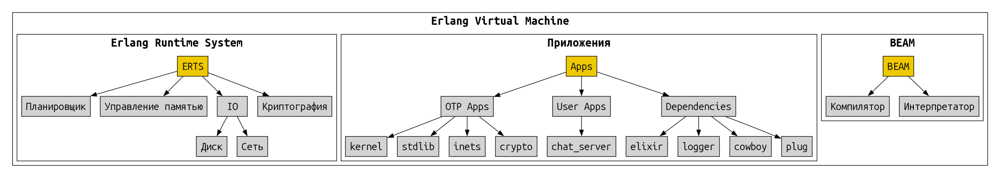
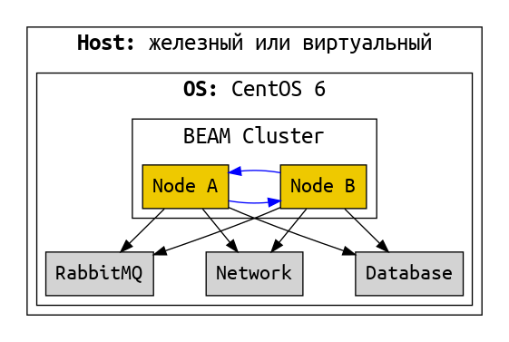
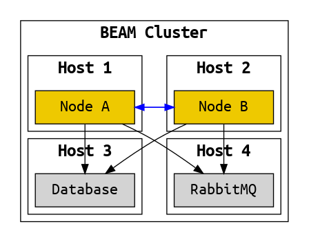
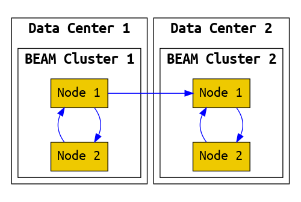

# Релиз

Ещё одна важная часть OTP это набор инструментов для сборки **релиза** -- упакованного для доставки на прод проекта. 

В состав релиза входит:
- скомпилированный код (байткод) всех Application;
- байткод всех необходимых зависимостей;
- скрипты загрузки системы;
- скрипты для управления системой (запуска, остановка, remote console и тд);
- конфигурация;
- ERTS -- Erlang Runtime System (виртуальная машина).

В состав релиза не входит:
- mix;
- исходный код;
- код тестов;
- зависимости, нужные только для тестов;
- любые файлы проекта, для которых явно не указано, что они должны быть в релизе.

Опционально в состав релиза можно включить ERTS (виртуальную машину). Если мы не включаем виртуальную машину, то она должна быть установлена на тех хостах, куда мы будем доставлять проект. Причем, что важно, в нужной версии. Бывает проще включить виртуальную машину в состав релиза, и тогда не требуется её наличия на хостах.

В обоих случаях доставленая и развёрнутая на хосте система выглядит так:



Это минимальная система, состоящая из одного узла.

Не редко система представляет собой кластер из нескольких узлов. Причём этот кластер не самодостаточный, а ему необходимо наличие базы данных, очереди сообщений и взаимодействие с другими системами по сети:



В этом варианте все компоненты развернуты на одном хосте. Такое бывает на стейджинг окружениях и на машине разработчика. Но реально использующаяся система (production) разворачивается на нескольких хостах:



Если пойти еще дальше, то можно построить федерацию -- систему из нескольких кластеров, находящихся в разных датацентрах:




## Сборка и запуск

Давайте соберём релиз `chat_server`: 

```
$ mix release
* assembling chat_server-0.1.0 on MIX_ENV=dev
* skipping runtime configuration (config/runtime.exs not found)

Release created at _build/dev/rel/chat_server
...
```

И посмотрим из чего он состоит:

```
$ tree -L 2 _build/dev/rel/chat_server
_build/dev/rel/chat_server
├── bin
│   ├── chat_server
│   └── chat_server.bat
├── erts-17.0.2
│   └── bin
├── lib
│   ├── chat_server-0.1.0
│   ├── compiler-10.0.1
│   ├── elixir-1.20.1
│   ├── iex-1.20.1
│   ├── kernel-11.0.2
│   ├── logger-1.20.1
│   ├── sasl-4.4
│   └── stdlib-8.0.1
└── releases
    ├── 0.1.0
    ├── COOKIE
    └── start_erl.data
```

`bin` -- исполняемые файлы для запуска приложения.
`erts` -- erlang runtime system.
`lib` -- байт-код приложения и всех зависимостей.
`release` -- служебные файлы для загрузки, конфигурации и обновления.

Посмотрим, как запустить приложение:
```
$ cd _build/dev/rel/chat_server/bin
$ ./chat_server
Usage: chat_server COMMAND [ARGS]

The known commands are:

    start          Starts the system
    start_iex      Starts the system with IEx attached
    daemon         Starts the system as a daemon
    daemon_iex     Starts the system as a daemon with IEx attached
    eval "EXPR"    Executes the given expression on a new, non-booted system
    rpc "EXPR"     Executes the given expression remotely on the running system
    remote         Connects to the running system via a remote shell
    restart        Restarts the running system via a remote command
    stop           Stops the running system via a remote command
    pid            Prints the operating system PID of the running system via a remote command
    version        Prints the release name and version to be booted
```

В k8s можно запускать прямо в консоли:
```
$ ./chat_server start      
ChatServer.start [:hello, :world]
Start SessionManager
```

Но если у нас виртуалка без k8s, то нужно запускать как фоновый процесс:
```
$ ./chat_server daemon
```

Подключиться iex-консолью к работающему узлу можно так:
```
$ ./chat_server remote
Erlang/OTP 29 [erts-17.0.2] [source] [64-bit] [smp:20:20] [ds:20:20:10] [async-threads:1] [jit:ns]

Interactive Elixir (1.20.1) - press Ctrl+C to exit (type h() ENTER for help)
iex(chat_server@yury-zhloba-desktop)1> Application.started_applications()
[
  {:iex, ~c"iex", ~c"1.20.1"},
  {:chat_server, ~c"chat_server", ~c"0.1.0"},
  {:logger, ~c"logger", ~c"1.20.1"},
  {:sasl, ~c"SASL  CXC 138 11", ~c"4.4"},
  {:elixir, ~c"elixir", ~c"1.20.1"},
  {:compiler, ~c"ERTS  CXC 138 10", ~c"10.0.1"},
  {:stdlib, ~c"ERTS  CXC 138 10", ~c"8.0.1"},
  {:kernel, ~c"ERTS  CXC 138 10", ~c"11.0.2"}
]
```

Ну и остановить фоновый процесс:
```
$ ./chat_server stop
```

## Как работает конфигурация

Конфигурация работает немного по-разному локально, на машине разработчика, и в релизе развёрнутом на проде.

При локальном запуске `mix` ищет и выполняет файл `config/config.exs`:

```
import Config

config :chat_server,
  connection_heartbeat: 2_000,
  param_a: "a",
  param_b: "b"
```

Импорт модуля `Config` загружает макросы `config/2`, `config/3`, `config_env/0` и другие. Этими макросами задаётся конфигурация для каждого приложения, в том числе для библиотек.

mix поддерживает несколько окружений: dev, test, prod. Часто бывает необходимо иметь разную конфигурацию для разных окружений. Например, разный коннект к БД для dev и test.

Для этого создают отдельные файлы `config/dev.exs`, `config/test.exs`, `config/prod.exs`. И подключают их в `config/config.exs` с помощью `import_config`:

```
import_config "#{config_env()}.exs"
```

Запустим `chat_server` с разными окружениями:

```
$ iex -S mix 
Start ChatServer
Start SessionManager
iex(1)> Application.get_all_env(:chat_server)
[connection_heartbeat: 2000, param_b: "b-dev", param_a: "a-dev"]

$ MIX_ENV=test iex -S mix
Start ChatServer
Start SessionManager
iex(1)> Application.get_all_env(:chat_server)
[connection_heartbeat: 2000, param_b: "b-test", param_a: "a-test"]
```

При сборке релиза вся эта конфигурация упаковывается в файл `sys.config`: 

```
MIX_ENV=prod mix release
```

```
$ cat _build/dev/prod/chat_server/releases/0.1.0/sys.config
%% coding: utf-8
%% RUNTIME_CONFIG=false
[
  {chat_server,[
    {connection_heartbeat,2000},
    {param_a,<<"a-prod">>},
    {param_b,<<"b-prod">>}
  ]},
  {elixir,...
```

Однако, мы не можем держать конфигурацию для прода прямо в репозитории проекта. К тому же, нужна разная конфигурация для разных машин на проде. Поэтому нужен способ переопределить конфигурацию для конкретной машины.

Поэтому mix ищет и выполняет ещё один файл -- `config/runtime.exs`. Этот файл упаковывается в релиз отдельно. И его можно заменить на каждой машине, где разворачивается релиз. 

Однако при сложившейся традиции разворачивания сервисов в k8s и конфигурирования их через переменные окружения, файл `runtime.exs` не заменяют, а внутри него загружают значения из переменных окружения:

```
import Config

config :chat_server,
  param_a: System.get_env("PARAM_A", "a-default")
```

Важно понять, что `System.get_env` во всех `config/*.exs` кроме `runtime.exs` выполяется при сборке релиза и испльзует окружение той машины, где происходит сборка (и обычно в этом нет смысла, кроме каких-то экзотических случаев). А `System.get_env` в `runtime.exs` выполянется каждый раз при запуске сервиса на продовой машине и в окружении продовой машины (ну или в окружении пода k8s).

При локальном запуске `runtime.exs` тоже выполняется.

```
$ iex -S mix 
Start ChatServer
Start SessionManager
iex(1)> Application.get_all_env(:chat_server)
[connection_heartbeat: 2000, param_b: "b-dev", param_a: "a-default"]

$ MIX_ENV=test iex -S mix
Start ChatServer
Start SessionManager
iex(1)> Application.get_all_env(:chat_server)
[connection_heartbeat: 2000, param_b: "b-test", param_a: "a-default"]

$ MIX_ENV=test PARAM_A=a_from_env iex -S mix
Start ChatServer
Start SessionManager
iex(1)> Application.get_all_env(:chat_server)
[connection_heartbeat: 2000, param_b: "b-test", param_a: "a_from_env"]
```

Ну и при запуске релиза тоже выполнятся:

```
MIX_ENV=prod mix release

$ _build/prod/rel/chat_server/bin/chat_server start_iex
Start ChatServer
Start SessionManager
iex(chat_server@yury-zhloba-desktop)1> Application.get_all_env(:chat_server)
[param_a: "a-default", param_b: "a-prod", connection_heartbeat: 2000]
```

## Настройки виртуальной машины.

Кроме конфигурации приложения есть ещё настройки виртуальной машины. Для этого есть отдельные файлы в составе релиза `vm.args` и `env.sh`. Можно создать в своём проекте шаблоны для генерации этих файлов:

```
chat_server $ mix release.init
* creating rel/vm.args.eex
* creating rel/remote.vm.args.eex
* creating rel/env.sh.eex
* creating rel/env.bat.eex
```

В файле `vm.args` указываются флаги для виртуальной машины. Например:
```
+P 262144 # лимит на количество процессов
+Q 65536 # лимит на количество портов
+A 4 # размер асинхронного пула
```

- настройки шедулеров
- настройки для управления памятью
- настройки IO
- и куча других


## Горячее обновление

На момент создания виртуальной машины в 80-х - 90-х годах горячее обновление кода было важной фичей. Причём речь идёт не просто об обновлении кода одного или нескольких модулей, а о горячем переключении на следующую версию приложения.

Для этого в релизе предусмотрены механизмы загрузки кода, переключения процессов на новый код, миграция состояния процессов на новые структуры данных, изменения в дереве супервизоров. Миграцию на новую версию нужно реализовать и протестировать. Более того, ещё нужно реализовать и протестировать откат на старую версию.

Это слишком сложно, и этим теперь никто не пользуется. Проще просто перезапустить приложение. А отсутствие downtime, если это нужно, обеспечивается на другом уровне -- запуском нескольких узлов и балансировкой нагрузки между ними. 

Горячее обновление кода остаётся удобной фичёй для локальной разработки, но не нужно на проде.


