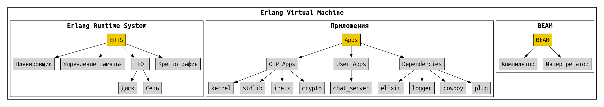
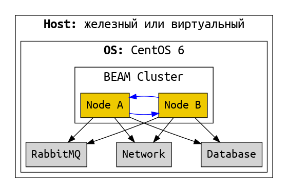
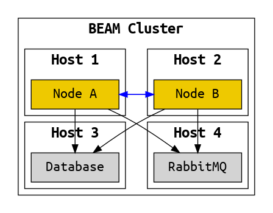
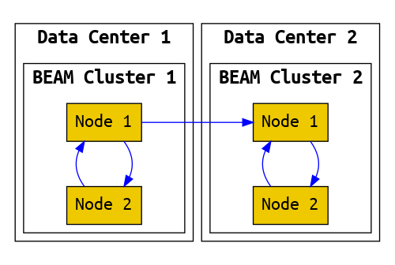

# Релиз

Ещё одна важная часть OTP это набор инструментов для сборки **релиза** -- упакованного для доставки на прод проекта. 

В состав релиза входит:
- скомпилированный код (байткод) всех Application;
- байткод всех необходимых зависимостей;
- скрипты загрузки системы;
- скрипты для управления системой (запуска, остановка, remote console и тд);
- конфигурация;
- ERTS -- Erlang Runtime System (виртуальная машина).

В состав релиза не входит:
- mix;
- исходный код;
- код тестов;
- зависимости, нужные только для тестов;
- любые файлы проекта, для которых явно не указано, что они должны быть в релизе.

Опционально в состав релиза можно включить ERTS (виртуальную машину). Если мы не включаем виртуальную машину, то она должна быть установлена на тех хостах, куда мы будем доставлять проект. Причем, что важно, в нужной версии. Бывает проще включить виртуальную машину в состав релиза, и тогда не требуется её наличия на хостах.

В обоих случаях доставленая и развёрнутая на хосте система выглядит так:



Это минимальная система, состоящая из одного узла.

Не редко система представляет собой кластер из нескольких узлов. Причём этот кластер не самодостаточный, а ему необходимо наличие базы данных, очереди сообщений и взаимодействие с другими системами по сети:



В этом варианте все компоненты развернуты на одном хосте. Такое бывает на стейджинг окружениях и на машине разработчика. Но реально использующаяся система (production) разворачивается на нескольких хостах:



Если пойти еще дальше, то можно построить федерацию -- систему из нескольких кластеров, находящихся в разных датацентрах:




## Сборка и запуск

Давайте соберём релиз `chat_server`: 

```
$ mix release
* assembling chat_server-0.1.0 on MIX_ENV=dev
* skipping runtime configuration (config/runtime.exs not found)

Release created at _build/dev/rel/chat_server
...
```

И посмотрим из чего он состоит:

```
$ tree -L 2 _build/dev/rel/chat_server
_build/dev/rel/chat_server
├── bin
│   ├── chat_server
│   └── chat_server.bat
├── erts-17.0.2
│   └── bin
├── lib
│   ├── chat_server-0.1.0
│   ├── compiler-10.0.1
│   ├── elixir-1.20.1
│   ├── iex-1.20.1
│   ├── kernel-11.0.2
│   ├── logger-1.20.1
│   ├── sasl-4.4
│   └── stdlib-8.0.1
└── releases
    ├── 0.1.0
    ├── COOKIE
    └── start_erl.data
```

`bin` -- исполняемые файлы для запуска приложения.
`erts` -- erlang runtime system.
`lib` -- байт-код приложения и всех зависимостей.
`release` -- служебные файлы для загрузки, конфигурации и обновления.

Посмотрим, как запустить приложение:
```
$ cd _build/dev/rel/chat_server/bin
$ ./chat_server
Usage: chat_server COMMAND [ARGS]

The known commands are:

    start          Starts the system
    start_iex      Starts the system with IEx attached
    daemon         Starts the system as a daemon
    daemon_iex     Starts the system as a daemon with IEx attached
    eval "EXPR"    Executes the given expression on a new, non-booted system
    rpc "EXPR"     Executes the given expression remotely on the running system
    remote         Connects to the running system via a remote shell
    restart        Restarts the running system via a remote command
    stop           Stops the running system via a remote command
    pid            Prints the operating system PID of the running system via a remote command
    version        Prints the release name and version to be booted
```

В кубе можно запускать прямо в консоли:
```
$ ./chat_server start      
ChatServer.start [:hello, :world]
Start SessionManager
```

Но если у нас виртуалка без куба, то нужно запускать как фоновый процесс:
```
$ ./chat_server daemon
```

Подключиться iex-консолью к работающему узлу можно так:
```
$ ./chat_server remote
Erlang/OTP 29 [erts-17.0.2] [source] [64-bit] [smp:20:20] [ds:20:20:10] [async-threads:1] [jit:ns]

Interactive Elixir (1.20.1) - press Ctrl+C to exit (type h() ENTER for help)
iex(chat_server@yury-zhloba-desktop)1> Application.started_applications()
[
  {:iex, ~c"iex", ~c"1.20.1"},
  {:chat_server, ~c"chat_server", ~c"0.1.0"},
  {:logger, ~c"logger", ~c"1.20.1"},
  {:sasl, ~c"SASL  CXC 138 11", ~c"4.4"},
  {:elixir, ~c"elixir", ~c"1.20.1"},
  {:compiler, ~c"ERTS  CXC 138 10", ~c"10.0.1"},
  {:stdlib, ~c"ERTS  CXC 138 10", ~c"8.0.1"},
  {:kernel, ~c"ERTS  CXC 138 10", ~c"11.0.2"}
]
```

Ну и остановить фоновый процесс:
```
$ ./chat_server stop
```

## Как работает конфигурация

Whenever you invoke a mix command, Mix loads the configuration in config/config.exs, if said file exists. 
It is common for the config/config.exs file itself to import other configuration based on the current MIX_ENV, 
such as config/dev.exs, config/test.exs, and config/prod.exs, by calling Config.import_config/1:

```
import Config
import_config "#{config_env()}.exs"
```

To enable runtime configuration in your release, all you need to do is to create a file named config/runtime.exs.
This file will be executed whenever your Mix project or your release starts.

Your config/runtime.exs file needs to follow three important rules:
It MUST import Config at the top instead of the deprecated use Mix.Config
It MUST NOT import any other configuration file via import_config
It MUST NOT access Mix in any way, as Mix is a build tool and it is not available inside releases

If a config/runtime.exs exists, it will be copied to your release and executed early in the boot process, when only Elixir and Erlang's main applications have been started.


config/config.exs (and config/prod.exs) - provides build-time application configuration, which are executed when the release is assembled

config/runtime.exs - provides runtime application configuration. It is executed every time your Mix project or your release boots and is further extensible via config providers. If you want to detect you are inside a release, you can check for release specific environment variables, such as RELEASE_NODE or RELEASE_MODE

rel/vm.args.eex and rel/remote.vm.args.eex - template files that are copied into every release and provides static configuration of the Erlang Virtual Machine and other runtime flags. vm.args runs on start, daemon, and eval commands. remote.vm.args configures the VM for remote and rpc commands

rel/env.sh.eex and rel/env.bat.eex - template files that are copied into every release and are executed on every command to set up environment variables, including specific ones to the VM, and the general environment


### Emulator flags

vm.args

Deal with memory management, multicore architectures, ports and sockets, low-level tracing, or other internal optimizations.

also:

+Bc -- disables the shell break handler, so when you press the sequence Ctrl-c a,
instead of terminating the virtual machine you terminate just the shell process and restart it

+e Num -- sets the maximum number of ETS tables, which defaults to 2,053

+P Num -- system limit on the maximum number of processes allowed to exist simultaneously.
default is 262,144, range from 1,024 to 134,217,727.

+Q Num -- maximum number of ports allowed in the system,
default to 65,536. range is 1,024 to 134,217,727.

+t Num -- maximum number of allowed atoms, set by default to 1,048,576.


## Доставка (Deployment)

A **deployment** is a way of getting a release into an environment where it can be used.

Машина, на которой происходит сборка релиза должна соответствовать машине, где система будет запускаться и работать:
- OS, 
- kernel version, 
- architecture, 
- and system libraries. 

Теоретически релиз может быть в некоторой мере кросс-платформенным: BEAM-файлы, конфигурация и bash-скрипты.
Но если в него включена ERTS, то она привязана к конкретной ОС и архитектуре, и зависит от системных библиотек.
(А если ERTS не включена, то подразумевается, что на целевой машине она уже есть, и в нужной версии).
Кроме того, в зависимостях могут быть библиотеки, включающие C-код. 

Можно подготовить соответствующий докер-контейнер, и собирать в нем.
Или можно собирать в CI на какой-то специально подготовленной для этого машине.

https://hexdocs.pm/distillery/guides/deploying_to_aws.html

## Live upgrade

как это работает

почему оно было нужно в телекоме, и почему оно не нужно сейчас

_build/prod/rel/proj_name/releases/0.1.0/proj_name.tar.gz
This file plays important role in live upgrade.
bin/proj_name upgrade "0.2.0"

- migrate state of stateful processes (gen_server.code_change);
- migrate state of ETS tables;
- reconfigure supervision tree;
- restart OTP apps.

Alternative approach: restart nodes in cluster one by one.


A **hot upgrade** is a kind of deployment that allows the release of a currently running application
to be changed while that application continues to run —
the upgrade happens in place with no user-detectable disruption.

Appup - A file containing Erlang terms which describes with **high-level** instructions how to upgrade and downgrade between the current release and one or more older releases.

Relup - A file containing Erlang terms which describes with **low-level** instructions how to upgrade and downgrade between the current release and one or more older releases.
